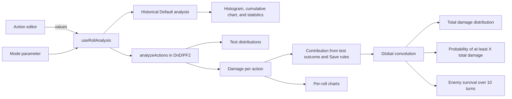

# Architecture

RPGStats is a Vue 3 + TypeScript application. Default mode preserves the historical analysis of a single expression; DnD and PF2 use a multi-action model. The domain calculates exact discrete distributions, and the interface displays the results with Chart.js.

## Responsibilities

- `domain/dice/types.ts` defines the modes, supported dice, roll conditions, and d20 outcome results.
- `domain/dice/actionTypes.ts` defines actions, enemy statistics, Save settings, damage rolls, and distribution formats exposed to the interface.
- `domain/dice/actionAnalysis.ts` calculates per-roll and per-action damage distributions, resolves enemy AC/save targets, applies Save settings and per-type enemy damage traits, and combines all action contributions.
- `domain/dice/survivalAnalysis.ts` repeatedly convolves a turn's total damage distribution, capped by enemy HP, to calculate survival probabilities over a fixed horizon.
- `domain/dice/probability.ts` builds dice distributions and classifies tests according to the current mode rules.
- `domain/dice/damageTypes.ts` provides the suggested type catalog, filtered by mode, with default colors.
- `domain/dice/rollExpression.ts` preserves historical expression parsing.
- `composables/useRollAnalysis.ts` manages historical Default analysis, actions, and URL mode synchronization.
- `composables/useChartLifecycle.ts` centralizes chart mounting, reactive updates, and teardown for chart components.
- `components/AnalysisControls.vue` edits the DC and mode; it presents the historical expression in Default or the action editor in DnD/PF2.
- `components/ActionResults.vue`, `DistributionChart.vue`, and `DamageComparisonChart.vue` present per-roll damage and global distributions.
- `App.vue` composes the interface.

Shared calculation types are imported from `domain/dice/`; the utility module `utils/diceProbability.ts` remains a compatibility facade for calculation helpers.

## Calculation flow



Each action carries its own d20 test. Without an enemy, it uses that action's test modifier and DC. With an enemy, regular actions use the enemy AC and the action modifier, while Save actions use the selected enemy save modifier and the action DC. Advantage or Disadvantage applies to the test in DnD only; it never affects damage dice. In DnD, a natural 1 or 20 on the single d20 test is a critical failure or critical success, respectively; other results are classified as success or failure against the DC. PF2 classifies degrees by the result's difference from the DC (10 or more above is critical success, 10 or more below is critical failure), then shifts the degree one step for a natural 20 or natural 1. Default mode classifies results only as success or failure against its optional DC.

Regular actions deal damage on either success degree. On critical success, DnD uses the selected critical-damage rule: RAW doubles the number of damage dice but applies modifiers once, while Alternative adds the maximum possible dice result to normal damage. PF2 doubles final damage on critical success. Non-basic Saves deal normal damage on either failure degree and no damage on success. Basic Saves double damage on critical failure, deal normal damage on failure, halve and round down on success, and deal no damage on critical success. The optional reroll-1 damage setting rerolls each damage die showing 1 once; it does not apply to d20 tests.

Enemy damage traits are applied per action and damage type after test-based damage scaling. Immunity reduces matching damage to zero. DnD resistance halves matching damage, rounded down, and weakness doubles it. PF2 resistance subtracts its configured value (minimum zero); weakness adds its configured value to a positive matching damage instance. When both resistance and weakness apply to one type, resistance is applied first; immunity takes precedence over both.

Damage rolls in one action combine by convolution. Each roll's result, including its modifier, is capped at zero; an action with no damage always contributes zero.

Each action's contribution distribution combines its conditional damage distribution with the test outcome probabilities, applying the action's regular, Save, or Basic Save rule for each degree. Contributions are convolved to obtain the exact total damage distribution. The global views require a valid integer DC for every action and valid damage expressions; conditional per-roll distributions remain available without a DC.

The total damage distribution is also used to calculate the probability of reaching or exceeding each damage threshold `X`.
When enemy HP is a positive integer, this distribution is repeatedly applied for 10 turns to show the probability that cumulative damage remains below HP.

The DC can be left empty to inspect conditional per-roll damage distributions; a valid per-action DC or enemy target is required for its success probability and contribution to the global distributions. Damage-roll-specific conditions other than the optional reroll of 1s are not modeled.

## Damage catalog

The catalog in `domain/dice/damageTypes.ts` associates each label with its available modes and default color. DnD offers Acid, Bludgeoning, Cold, Fire, Force, Lightning, Necrotic, Piercing, Poison, Psychic, Radiant, Slashing, and Thunder. PF2 offers Bludgeoning, Piercing, Slashing, Acid, Cold, Electricity, Fire, Sonic, Vitality, Void, Force, Spirit, Mental, Poison, Bleed, Precision, Holy, and Unholy. The UI limits type selection to the active mode; selecting a type applies its default color, which can be customized per roll in memory.

Default-mode expressions accept d2, d4, d6, d8, d10, d12, d20, and d100, with a maximum of 100 dice per group. Damage fields are free-form expressions validated by the same parser but limited to d2–d12. The expression's total is capped at zero after its modifier.

## Verification

```sh
npm run build
```
